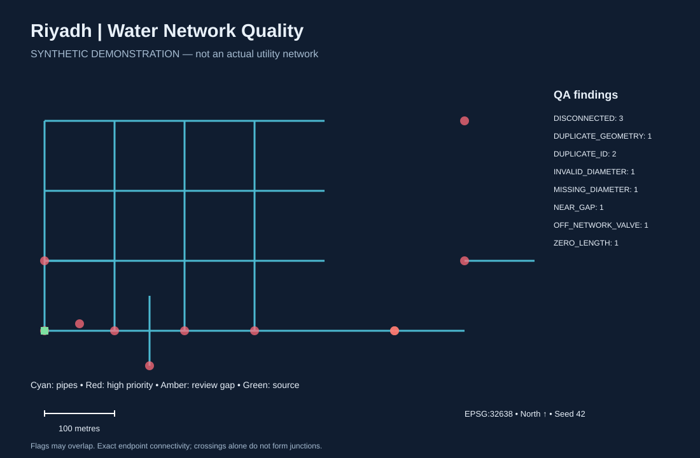

# Riyadh Water Network GIS Quality Assessment

**Synthetic portfolio demonstration · QGIS · PostGIS · Python · GIS QA/QC**

A reproducible case study for detecting data issues before a water-network dataset is handed to planning or operations teams. It models a small illustrative area in Riyadh using **entirely synthetic assets**. No utility records, customer information, or external basemap are used. This is not a hydraulic model, an engineering design, or a real client engagement.



## Results

34 pipe records, 2 valves, 1 source. The independent Python checker produced **11 findings before** and **9 after** two documented ID repairs. These are findings, not unique assets or accuracy measurements. Geometry and connectivity concerns remain for manual review.

| Rule | Before | After |
|---|---:|---:|
| Duplicate asset IDs | 2 | 0 |
| Missing diameter | 1 | 1 |
| Non-positive diameter | 1 | 1 |
| Zero-length pipe | 1 | 1 |
| Duplicate pipe geometry | 1 | 1 |
| Near endpoint gap (0–2 m) | 1 | 1 |
| No endpoint route to source | 3 | 3 |
| Off-network valve (>2 m) | 1 | 1 |

## Start with QGIS — no database needed

Drag `data/network.gpkg` into QGIS. Add `pipes_raw`, `sources`, `valves`, and `qa_before`. Categorize QA symbols by `code` or `severity`. Compare `pipes_clean` and `qa_after` for the repaired version. Use EPSG:32638 (metres). Save your QGIS project with relative paths inside `qgis/`.

A ready-made `.qgz` is not included: this environment could export and validate the GeoPackage but did not validate a saved QGIS project. See [Thai setup guide](docs/GETTING_STARTED_TH.md) for the complete workflow.

## Reproduce the Python analysis

Python 3.9+; **no third-party Python dependencies**:

```sh
python3 scripts/build.py
python3 -m unittest discover -s tests -v
```

This regenerates projected GeoJSON, summary JSON, repair log and SVG. The supplied GeoJSON is a projected GIS interchange file with an explicit CRS, **not RFC 7946 web GeoJSON**. Do not display it on a web map without transforming to longitude/latitude.

To rebuild GeoPackage with a GDAL installation:

```sh
python3 scripts/build.py --ogr2ogr /path/to/ogr2ogr
```

On this Mac's QGIS bundle, use:

```sh
PROJ_DATA=/Applications/QGIS.app/Contents/Resources/qgis/proj \
GDAL_DATA=/Applications/QGIS.app/Contents/Resources/qgis/gdal \
python3 scripts/build.py --ogr2ogr /Applications/QGIS.app/Contents/MacOS/ogr2ogr
```

## Run the PostGIS workflow

Requirements: a running PostgreSQL instance, PostGIS installed, `psql` and `createdb` in PATH, and permission to create an extension. Use a **new dedicated database**; scripts create project schemas and do not drop existing schemas. No password is embedded. Supply your local connection details through PostgreSQL environment variables or `.pgpass`.

```sh
createdb riyadh_portfolio
psql -X -v ON_ERROR_STOP=1 -d riyadh_portfolio -f sql/01_schema.sql
psql -X -v ON_ERROR_STOP=1 -d riyadh_portfolio -f sql/02_seed.sql
psql -X -v ON_ERROR_STOP=1 -v pipe_table=water_raw.pipes -d riyadh_portfolio -f sql/03_qa.sql
psql -X -v ON_ERROR_STOP=1 -d riyadh_portfolio -f sql/04_clean.sql
psql -X -v ON_ERROR_STOP=1 -v pipe_table=water_clean.pipes -d riyadh_portfolio -f sql/03_qa.sql
```

`water_qa.findings` reflects the last selected pipe table. Query/export the raw results before replacing the view with cleaned results. Existing seed rows are kept on reruns, and clean rows are initialized only if absent: use a fresh database when you need a pristine rerun. `:pipe_table` is a psql identifier substitution; use only the two documented table names.

The SQL adds null/empty/invalid geometry checks. It uses a recursive endpoint graph without requiring pgRouting. It is intended for a small training dataset, not benchmarked for enterprise scale. See [data dictionary](docs/data-dictionary.md) for topology assumptions and differences from the Python checker.

## Evidence and limits

- Seven Python/GeoPackage tests passed, including expected affected records, clean terminals, non-connecting crossings, tolerance boundaries and unchanged geometry after repair.
- GDAL generated six EPSG:32638 GeoPackage layers; SQLite integrity and feature counts passed.
- The PostGIS server could not start in the execution sandbox (shared memory permission restriction). SQL is supplied but **database execution and Python/SQL parity remain unverified**.
- No QGIS GUI styling or saved project has been verified. The overview is a generated SVG, not a QGIS screenshot.
- Known synthetic IDs allow two administrative repairs. Real-world duplicate IDs require an authoritative register; the method must not invent replacements.
- No location-specific infrastructure claims are made. The illustrative grid is not aligned to actual Riyadh streets.

## Repository contents

- `scripts/build.py`: deterministic fixture, independent QA, GeoJSON and SVG output
- `sql/`: schema, fixture insertion, spatial QA and audited administrative repair
- `data/network.gpkg`: portable layers for QGIS
- `data/summary.json`: reproducible before/after counts
- `tests/test_qa.py`: meaningful fixture and GeoPackage checks
- `docs/case-study.md`: portfolio narrative and interview talking points
- `docs/data-dictionary.md`: fields, units and analytical assumptions
- `docs/GETTING_STARTED_TH.md`: Thai setup and publishing guide

## Portfolio description

Built a reproducible synthetic water-network QA workflow using Python, QGIS-ready GeoPackage layers and a PostGIS SQL implementation. Detected 11 data-quality findings across 34 pipe records, documented two authoritative ID repairs, and retained unresolved spatial issues for review. Verified the Python results and portable dataset with seven automated tests; PostGIS execution is pending.

## License

MIT for code and documentation; CC0 1.0 dedication for generated synthetic data and SVG, to the extent permitted by law. No third-party geographic data is bundled. See [LICENSE](LICENSE) and [data license](data/LICENSE.md).
